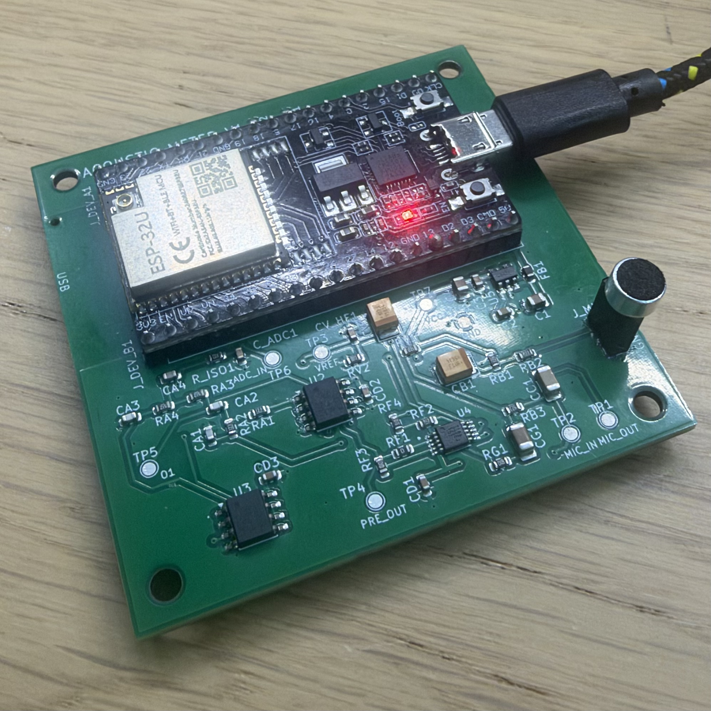
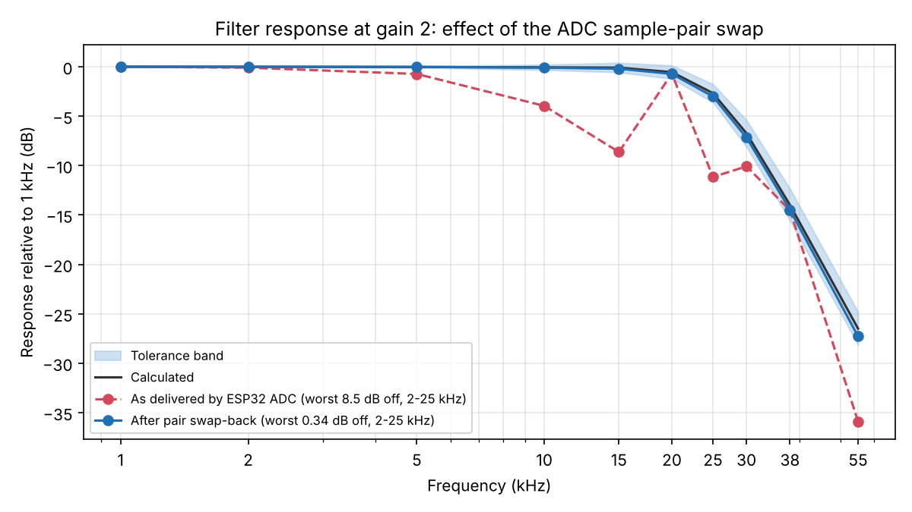
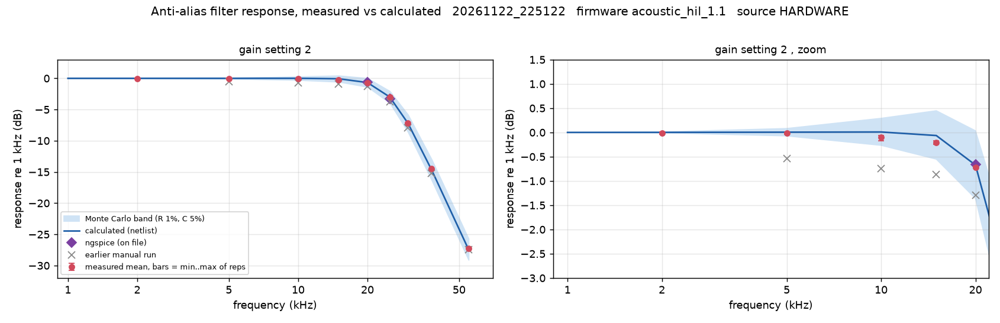

# Portable Acoustic Measurement System

A portable acoustic measurement instrument I designed, built and validated: an electret-microphone analog front end on a custom 2-layer KiCad board, an ESP32 sampling at 80 kSPS, and an automated Python hardware-in-the-loop test that checks the board against its design calculations.



## Highlights

- **Analog front end, designed from scratch:** electret capsule bias network, OPA2365 preamp with four switchable gains (TMUX1104), and a 4th-order Sallen-Key anti-alias filter (calculated -3 dB at 25.5 kHz), hand-routed on a 2-layer mixed-signal PCB.
- **Root-caused an 8.6 dB measurement error to the ESP32 ADC.** The continuous-mode driver returns every sample pair swapped. Undoing the swap brought the measured filter response within 0.37 dB of calculation through 25 kHz, and the test now checks sample order automatically before every run.
- **Automated hardware-in-the-loop validation:** `hil_sweep.py` drives the board over serial, sweeps 1 to 55 kHz, and compares each point against the calculation and a Monte Carlo tolerance band. At gain x100 the response sat inside the band at every point, within 0.35 dB of calculation up to 25 kHz.
- **End-to-end test on real sound:** with a phone as the source, measured level fell -5.46 dB per doubling of distance (inverse-square law predicts -6.02 dB), and 500 Hz to 4 kHz tones read within 0.014% of frequency, against pass criteria fixed before the data were taken.



*Gain 2, 22 Nov run. Red: samples as the ESP32 delivers them. Blue: after the pair swap-back. Generated from the saved per-capture log by [`plot_swap_effect.py`](validation/hil/plot_swap_effect.py); no value is re-measured.*

## Signal chain

WM-61B capsule -> bias network -> OPA2365 preamp with TMUX1104 gain select (nominal gains 1, 10.1, 101, 1001) -> two Sallen-Key low-pass sections (calculated -3 dB at 25.5 kHz) -> ESP32 ADC on GPIO34, 80 kSPS, continuous mode.

Test points on the board: TP1 MIC_OUT, TP2 MIC_IN, TP3 VREF, TP4 PRE_OUT, TP5 O1, TP6 ADC_IN, TP7 VCCA, TP8 GND.

## Validation status in detail

Every number here was measured and compared against a calculation. Full tables and the status of each result are in [docs/results.md](docs/results.md).

| Result | Status |
|---|---|
| ESP32 ADC returns sample pairs swapped; swap-back verified; checked automatically at the start of every run | VALID |
| Filter response at gain 2, 1 to 55 kHz vs calculation: inside the tolerance band at all 9 points on three runs (22 Nov), within 0.35 dB up to 25 kHz and 0.78 dB at worst; two later runs (23 Nov) were worse, up to 1.9 dB | PROVISIONAL: the injected signal level drifted between days |
| The 23 Nov drift is upstream of the filter (above 5 kHz the tone is lower by a nearly constant factor, with the same 5 to 55 kHz shape as on 22 Nov) | diagnosis, cause not found |
| Gain steps, noise, dynamic range from earlier manual runs | PROVISIONAL |
| End to end with a phone sound source, noise band 891 to 1122 Hz at 10/20/30 cm: level fell -5.46 dB per doubling of distance (expected -6.02, limit +/-1.5), 10 cm repeat -0.33 dB, 35.5 dB above silence | VALID for this scope: relative level, one room, one pass |
| End to end, tone frequency (500, 1000, 2000, 4000 Hz from a phone) read within 0.014 % | VALID, from a separate run; phone frequency not independently calibrated |
| Pure 1 kHz tone level test in a room | did not give a stable result in four real runs (room reflections); replaced by the noise-band test, all runs kept in `validation/hil/acoustic_results/` |
| Gain 1 and gain 3 filter response | NOT MEASURED |



The plot above is one run. The later runs that disagree are published beside it in [docs/results.md](docs/results.md), not hidden.

## Repository layout

| Path | What is in it |
|---|---|
| `validation/hil/` | Automated hardware-in-the-loop test: firmware (`acoustic_hil/acoustic_hil.ino`), `hil_sweep.py`, config generator, mock board, README |
| `validation/hil/results/` | Every hardware run: plot, per-capture log, summary and metadata, including bad runs |
| `validation/hil/acoustic_results/` | Every real end-to-end acoustic run (phone as sound source), including the failed and inconclusive ones |
| `docs/results.md` | Measured vs calculated, with status |
| `docs/img/` | Figures used in this README |
| `docs/lessons-learned.md` | What went wrong and what was learned |
| `docs/known-issues.md` | Open problems, what was not measured, ideas for a second revision |
| `hardware/photos/` | Photos of the assembled board: top-down and angled views |
| `hardware/` | KiCad project, schematic and layout |

## Running the validation

See [validation/hil/README.md](validation/hil/README.md). Short version: upload the firmware with Flash Mode DIO and Flash Frequency 40 MHz, close the Serial Monitor, connect GPIO25 -> 100 kohm -> TP2 and a 100 ohm resistor to TP3 (capsule unplugged), then:

```
python3 hil_sweep.py --port /dev/cu.usbserial-0001 --gains 2 --reps 3 --countdown 15 --baud 115200 --n-samples 8192 --settle-ms 300
```

`python3 hil_sweep.py --port mock` runs against a simulated board. Output from the mock is watermarked and is never a measurement.
