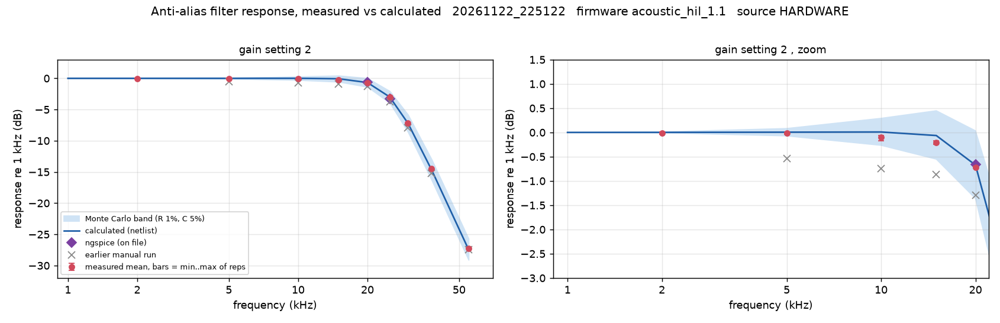
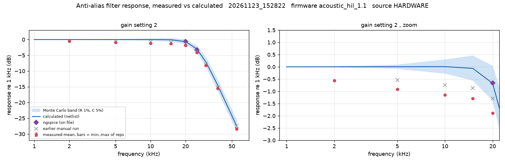

# Results: measured against calculation

Rule used throughout: a number is only reported if it was **measured and compared against a calculation or simulation**. Each result carries one status:

- **VALID**: measured, compared, and the obvious measurement artefacts were ruled out.
- **PROVISIONAL**: measured and compared, but an artefact is not ruled out or the result did not reproduce well.
- **NOT MEASURED**: no valid measurement exists.

All plots and CSVs are in [`validation/hil/results/`](../validation/hil/results/). Nothing was deleted: bad runs are listed too.

## Summary

- **Validated:** the ESP32 continuous ADC delivers samples with each pair swapped, and undoing that swap is required before any amplitude is measured (VALID, checked automatically at the start of every run).
- **Measured against calculation, not yet reproducible:** the anti-alias filter response at gain 2, 1 to 55 kHz, agrees with the calculation to 0.36 dB or better on the three runs of 22 Nov and to 1.23 dB or better on the two runs of 23 Nov (PROVISIONAL, because the injected signal level drifted between days).
- **Debugged with evidence:** the 23 Nov drift is upstream of the filter, because from 5 kHz upward the two drifted runs are lower by a nearly constant factor (about 2.7 dB and 1.75 dB) while the 5 to 55 kHz shape still matches the calculation to 0.3 dB or better (diagnostic only); the cause is not found.
- **Still open:** why the injected level drifted, gain 1 and gain 3 behaviour (NOT MEASURED), and re-checking the pre-HIL gain, noise and dynamic range numbers in the current hardware state.

## Signal chain and what was calculated

WM-61B electret capsule, bias network, OPA2365 preamp with TMUX1104 gain select (nominal 1, 10.1, 101, 1001), two Sallen-Key low-pass sections, ESP32 ADC (GPIO34) at 80 kSPS.

Filter calculation from the schematic values: stage 1 R 3.92 kohm, C feedback 1.8 nF, C ground 1.5 nF; stage 2 R 2.43 kohm, C feedback 6.8 nF, C ground 1.0 nF. Calculated -3 dB point: 25.02 kHz. The tolerance band is an **analytic** Monte Carlo (20,000 runs, resistors +/-1 %, capacitors +/-5 %, uniform, independent). It is not an ngspice run. See `validation/hil/make_config.py`.

## 1. Filter response, gain 2 (PROVISIONAL)

Method: a square wave from the ESP32 is injected through 100 kohm at the amplifier input with the capsule unplugged, and the filter output is captured by the ADC. The script undoes the pair swap, takes the amplitude of the fundamental with a Hann window (power summed over the peak bin +/-3, noise power removed), and normalises to the 1 kHz amplitude. 55 kHz is above the 40 kHz Nyquist limit and is measured as its 25 kHz alias.

### Table 1: gain 2, response relative to 1 kHz (dB), all five complete runs

| f (kHz) | calc | MC band | 11-22 22:33 | 11-22 22:51 | 11-22 22:53 | 11-23 15:28 | 11-23 15:36 |
|---|---|---|---|---|---|---|---|
| 1 kHz tone (counts) | | | 247 | 246 | 246 | 203 | 209 |
| 2 | +0.00 | -0.01 .. +0.01 | -0.01 | -0.01 | -0.01 | -0.56 | -0.30 |
| 5 | +0.01 | -0.07 .. +0.08 | -0.04 | -0.02 | -0.00 | -0.92 | -0.37 |
| 10 | +0.01 | -0.27 .. +0.29 | -0.16 | -0.10 | -0.03 | -1.15 | -0.45 |
| 15 | -0.06 | -0.55 .. +0.45 | -0.25 | -0.20 | -0.16 | -1.29 | -0.54 |
| 20 | -0.67 | -1.36 .. +0.03 | -0.75 | -0.72 | -0.74 | -1.89 | -1.14 |
| 25 | -2.99 | -3.93 .. -2.04 | -3.02 | -3.01 | -2.96 | -4.09 | -3.42 |
| 30 | -7.20 | -8.60 .. -5.81 | -7.18 | -7.18 | -7.06 | -8.25 | -7.51 |
| 38 | -14.67 | -16.30 .. -12.97 | -14.53 | -14.48 | -14.43 | -15.54 | -14.95 |
| 55 | -27.43 | -29.09 .. -25.70 | -27.07 | -27.28 | -27.14 | -28.41 | -27.82 |

Worst absolute gap to the calculation per run: 11-22 22:33: 0.36 dB, 11-22 22:51: 0.19 dB, 11-22 22:53: 0.30 dB, 11-23 15:28: 1.23 dB, 11-23 15:36: 0.47 dB.

### Table 2: the same runs normalised to 5 kHz (diagnostic, chosen after looking at the data): measured minus calculated (dB)

| f (kHz) | 11-22 22:33 | 11-22 22:51 | 11-22 22:53 | 11-23 15:28 | 11-23 15:36 |
|---|---|---|---|---|---|
| 1 | +0.05 | +0.02 | +0.01 | +0.93 | +0.37 |
| 2 | +0.03 | +0.01 | -0.01 | +0.36 | +0.07 |
| 10 | -0.13 | -0.08 | -0.04 | -0.23 | -0.09 |
| 15 | -0.13 | -0.12 | -0.09 | -0.30 | -0.10 |
| 20 | -0.03 | -0.03 | -0.06 | -0.29 | -0.10 |
| 25 | +0.01 | -0.00 | +0.04 | -0.18 | -0.06 |
| 30 | +0.07 | +0.05 | +0.15 | -0.13 | +0.06 |
| 38 | +0.19 | +0.22 | +0.25 | +0.05 | +0.10 |
| 55 | +0.41 | +0.18 | +0.30 | -0.05 | -0.01 |

From 10 to 55 kHz the worst gap in this table is 0.41 dB.

### Table 3: every hardware run

| run | gain | reps | 1 kHz tone (counts) | passes | note |
|---|---|---|---|---|---|
| 11-22 22:33 | 2 | 1 | 247 | 9/9 | clean state |
| 11-22 22:51 | 2 | 3 | 246 | 9/9 | clean state; spread over reps 0.03 to 0.11 dB |
| 11-22 22:53 | 2 | 1 | 246 | 9/9 | clean state; longer capture, same result |
| 11-23 14:47 | 1 | 3 | 21 | 4/7 | low signal; points 2 to 20 kHz vs calc -0.3 to -0.8 dB; spread up to 0.66 dB; no warning printed |
| 11-23 14:50 | 1 | 3 | 19 | 0/7 | low signal; 1 to 3 dB below calc; spread 0.5 to 0.9 dB |
| 11-23 15:28 | 2 | 3 | 203 | 3/9 | lower tone; constant offset above 5 kHz |
| 11-23 15:36 | 2 | 3 | 209 | 9/9 | lower tone; passes 2 to 10 kHz only on the 0.5 dB limit |
| 11-23 15:37 | 1 | 3 | 22 | 4/7 | INVALID: script warned the 1 kHz reference moved 1.18 dB between sweeps |

What this does and does not show:

- The three runs of 22 Nov are within 0.36 dB of the calculation at every point and inside the Monte Carlo band at every point except 2 kHz (which misses the +/-0.01 dB band by about 0.003 dB); the spread across repeats inside a run is 0.03 to 0.11 dB.
- On 23 Nov the 1 kHz tone at gain 2 had fallen from about 246 to about 203 and 209 counts, and the response relative to 1 kHz drooped by up to 1.2 dB. Runs on the same board, same script, same command. The filter is a passive RC network around an op-amp and cannot change by itself, so the change is in the injected signal, the contact, or something upstream.
- Table 2 supports "upstream of the filter": above 5 kHz the 23 Nov amplitudes are lower than the 22 Nov amplitudes by an almost constant factor, and the shape from 5 to 55 kHz still matches the calculation. That normalisation was chosen after seeing the data, so it is a diagnosis, not a headline result.
- The jumper wires are held by hand against bare pads. The tone level moved from run to run, which is consistent with contact quality, but this was not proven.
- Supply and bias, measured with the multimeter on 23 Nov with the jumpers off: TP7 (analog supply) 3.3 V, TP3 (reference) 1.5 V. These do not explain the drift.

## 2. Sample order (VALID)

The ESP32 continuous ADC driver returns the samples of each pair swapped (0 and 1, 2 and 3, and so on). On a tone this appears as a zigzag in the consecutive differences, about -d, +3d instead of a steady d; for example about -10 and +34 counts at 1 kHz. Amplitude read from swapped data is wrong, with the mirror amplitude proportional to |tan(2 pi f / fs)|. The script checks the order on a clean 1 kHz tone at the start of every run and aborts if it is not the expected swap mode. It passed on every run that reached that step. True sample rate: 80,000 Hz.

## 3. Hardware-in-the-loop timing

A single-gain sweep (10 frequencies, 3 repeats, 30 captures of 8192 samples) took 61.8 s of captures, 2.06 s per capture; 70.6 s from start to finished plot without the 15 s countdown, 85.7 s with it. A manual sweep was never timed, so no manual-versus-automated ratio is claimed.

## 4. Gain 1 (NOT MEASURED)

Three runs on 23 Nov (14:47, 14:50, 15:37) disagree with each other (at 2 kHz: -0.31, -1.07 and -0.13 dB) and with the calculation. The tone is only 19 to 22 counts at gain 1, and the script flagged the last run (1 kHz reference moved 1.18 dB between sweeps). None of it is used.

## 5. Gain 3 (NOT MEASURED)

Not run with the HIL tool. An earlier manual run suggested an extra roll-off near 16 kHz at gain 3; it was taken in a different hardware state and is unverified.

## 6. Earlier manual measurements (PROVISIONAL)

Taken before the HIL tool existed, and the hardware state at the time (a bias leak was present) is not guaranteed to match today's. Use with that caveat.

| Item | Measured | Calculated | Note |
|---|---|---|---|
| Stage gain steps at 931 Hz | x10.50, x9.23, x10.11 | x10.10, x10.00, x9.91 | Totals 20.43, 39.73, 59.83 dB vs 20.09, 40.09, 60.01 dB. Worst step 0.69 dB |
| Preamp noise, gain 3, input referred | about 1.17 uV (range 1.03 to 1.34) | 0.88 uV | ADC floor about 0.94 counts (0.76 mV) limits the measurement |
| Dynamic range | at least 55.0 dB (54.2 to 55.7) | 70.4 dB ideal | Limited by the source, not the board; a lower bound |
| Reference voltage | 1.5 V | 1.500 V | Multimeter, two digits |
| Capsule noise in a room | about 50 dB SPL unweighted, +/-4 dB | none | Room-limited, not a spec |
